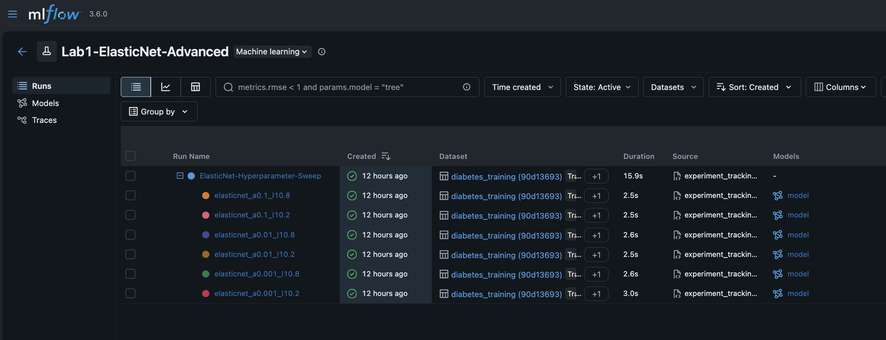
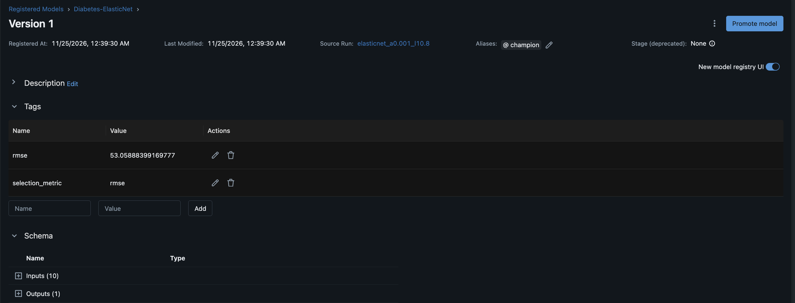
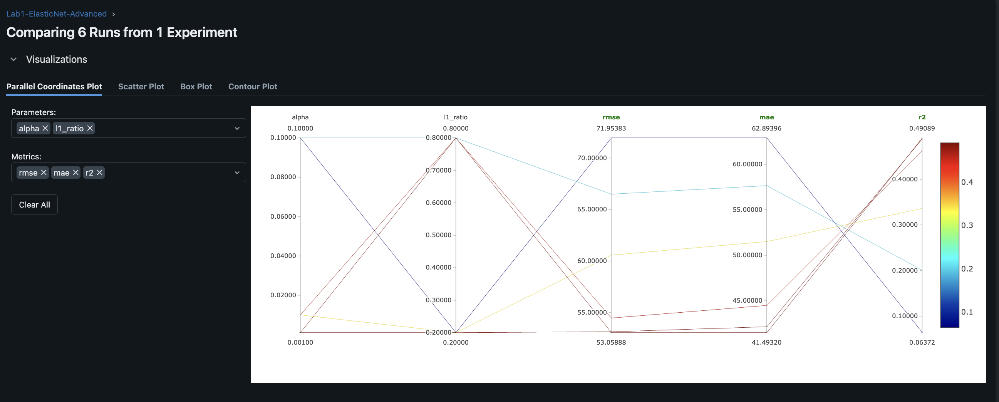
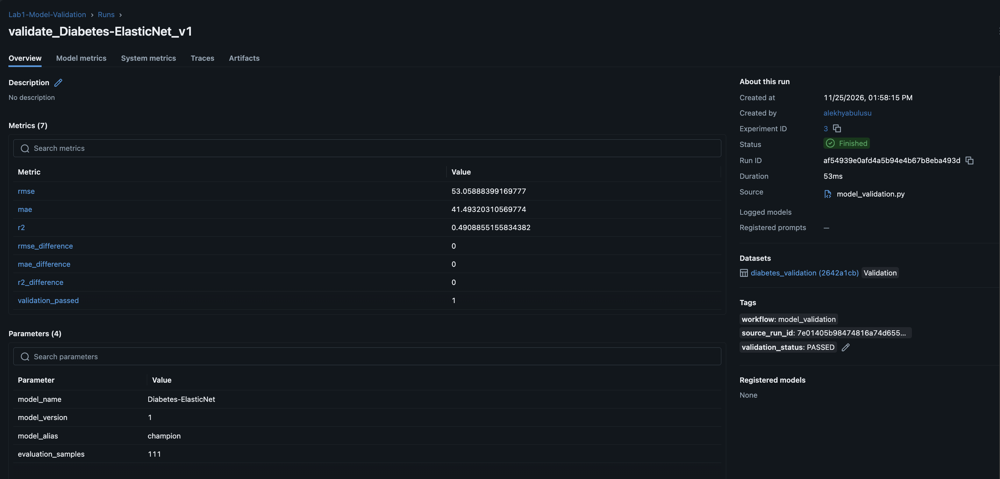

# MLOPS Lab 5 - MLflow

This lab extends the original MLflow lab into an automated machine learning experiment tracking and model lifecycle management workflow.

This implementation expands the MLflow functionality by introducing automated hyperparameter experimentation, parent and nested runs, dataset lineage, automatic model selection, model registration, model versioning, champion aliases, artifact management, and registered model validation.

The project uses the Scikit-learn Diabetes dataset to predict a quantitative measure of disease progression.

## Objectives

- Automate multiple machine learning experiments.
- Track hyperparameters, evaluation metrics, and model artifacts.
- Organize experiments using parent and nested MLflow runs.
- Track training and evaluation dataset lineage.
- Automatically select and register the best-performing model.
- Manage registered model versions using aliases.
- Validate registered models without retraining.
- Ensure reproducibility through unit and integration testing.

## Changes Made to the Original Lab

| Component | Original Implementation | Modified Implementation |
|---|---|---|
| Dataset | Red Wine Quality | Scikit-learn Diabetes |
| Dataset loading | External CSV URL | Built-in offline dataset |
| Model | ElasticNet | ElasticNet |
| Experiment execution | One configuration per execution | Automated hyperparameter sweep |
| Experiment organization | Independent runs | Parent and nested runs |
| Tracking backend | Default configuration | Persistent SQLite database |
| Dataset tracking | Limited metadata | MLflow dataset lineage |
| Parameter tracking | Alpha and L1 ratio | Hyperparameters and reproducibility metadata |
| Model logging | Individual model logging | Model logging for every trial |
| Model selection | Manual comparison | Automatic selection using RMSE |
| Model registration | Conditional registration | Automatic registration of the selected model |
| Model versioning | Basic registry functionality | Automated version creation and champion alias |
| Model validation | No dedicated reproducibility validation | Independent registered model validation |
| Experiment reports | No automated comparison reports | JSON and CSV reports logged as artifacts |
| Testing | No dedicated test suite | Eight unit tests and one integration test |

Redundant notebooks, introductory materials, and superseded training and serving scripts were removed to create a standalone repository.

The modified lab focuses on experiment tracking and model lifecycle management. It does not implement a live model-serving endpoint.

## Project Architecture

    Diabetes Dataset
           |
           v
    Reproducible Train/Evaluation Split
           |
           v
    MLflow Parent Experiment Run
           |
           v
    Six Nested Hyperparameter Runs
           |
           v
    Log Parameters, Metrics, Datasets and Models
           |
           v
    Select Model with Lowest RMSE
           |
           v
    MLflow Model Registry
           |
           v
    Assign Champion Alias
           |
           v
    Reload Registered Model
           |
           v
    Validate Metrics and Log Reports

## Repository Structure

    MLOps_lab5/
    ├── experiment_tracking.py
    ├── model_validation.py
    ├── test_experiment_tracking.py
    ├── requirements.txt
    ├── requirements-lock.txt
    ├── README.md
    ├── .gitignore
    └── screenshots/

### File Descriptions

- `experiment_tracking.py`: Implements automated hyperparameter experiments, nested MLflow runs, dataset lineage, model logging, best-model selection, model registration, and report generation.
- `model_validation.py`: Loads the registered champion model and verifies that its evaluation metrics match the original training run.
- `test_experiment_tracking.py`: Contains eight unit tests and one end-to-end MLflow integration test.
- `requirements.txt`: Contains the project's pinned direct dependencies.
- `requirements-lock.txt`: Records the complete dependency versions from the tested environment.
- `.gitignore`: Excludes virtual environments, caches, databases, and generated artifacts.
- `screenshots/`: Contains evidence of MLflow dashboard results.

## Prerequisites

Install the following software before running the project:

1. Python 3.13.5
2. Git
3. A terminal or command prompt.
4. A web browser for accessing the MLflow dashboard.

Visual Studio Code is optional.

The lab was developed and tested on macOS ARM64 (Apple Silicon).

The dataset is included with Scikit-learn and does not require a separate download.

No cloud account, API key, Docker installation, or external database is required.

## Installation and Environment Setup

### Step 1: Obtain the repository

Clone the submitted GitHub repository using its HTTPS URL, or download the repository as a ZIP file and extract it.

Open a terminal inside the extracted or cloned project directory.

### Step 2: Verify Python installation

    python3 --version

The tested Python version is:

    Python 3.13.5

On Windows, use `python --version` or `py -3.13 --version`.

### Step 3: Create a virtual environment

macOS/Linux:

    python3.13 -m venv .venv
    source .venv/bin/activate

Windows PowerShell:

    py -3.13 -m venv .venv
    .venv\Scripts\Activate.ps1

The terminal should display `(.venv)` after activation.

### Step 4: Install dependencies

    python -m pip install --upgrade pip
    python -m pip install -r requirements.txt

For reproducing the complete tested macOS environment, the dependency snapshot can alternatively be installed using:

    python -m pip install -r requirements-lock.txt

The lock file was generated on macOS ARM64. Compatibility with other operating systems has not been verified.

### Step 5: Verify dependency installation

    python -m pip check

Expected output:

    No broken requirements found.

## Tested Environment

| Dependency | Version |
|---|---|
| Python | 3.13.5 |
| MLflow | 3.6.0 |
| SQLAlchemy | 2.0.58 |
| Scikit-learn | 1.7.2 |
| NumPy | 2.2.6 |
| SciPy | 1.18.1 |
| Pandas | 2.3.3 |
| Pytest | 9.2.0 |
| Operating system | macOS ARM64 |

## Dataset

The project uses the Diabetes dataset available through `sklearn.datasets.load_diabetes`.

Dataset characteristics:

- Total samples: 442
- Input features: 10
- Training samples: 331
- Evaluation samples: 111
- Evaluation split: 25%
- Random seed: 42
- Task: Regression

The fixed random seed ensures that the same training and evaluation split can be reproduced during model validation.

Training and evaluation datasets are recorded in MLflow using `mlflow.log_input()`.

## Running the Experiments

Activate the virtual environment and execute:

    python experiment_tracking.py

The script automatically:

1. Loads and splits the dataset.
2. Initializes the SQLite tracking backend.
3. Creates an MLflow experiment.
4. Starts a parent experiment run.
5. Trains six ElasticNet configurations in nested runs.
6. Logs hyperparameters and evaluation metrics.
7. Records training and evaluation dataset lineage.
8. Logs trained models with signatures and input examples.
9. Selects the model with the lowest RMSE.
10. Registers the selected model.
11. Assigns the champion alias.
12. Generates and logs experiment comparison reports.

### Experiment Configuration

The default hyperparameter values are:

- Alpha: 0.001, 0.01, 0.1
- L1 ratio: 0.2, 0.8
- Maximum iterations: 10000
- Random seed: 42

A total of six model configurations are evaluated.

Custom hyperparameters can also be supplied:

    python experiment_tracking.py --alphas 0.001 0.01 0.1 --l1-ratios 0.2 0.8

## MLflow Tracking

The experiment uses the following configuration:

- Tracking URI: `sqlite:///mlflow.db`
- Experiment name: `Lab1-ElasticNet-Advanced`
- Parent run: `ElasticNet-Hyperparameter-Sweep`
- Registered model: `Diabetes-ElasticNet`
- Model alias: `champion`

The SQLite database and model artifacts are generated automatically during execution.

### Starting the MLflow Dashboard

Open a second terminal in the project directory, activate the virtual environment, and run:

   mlflow ui --backend-store-uri sqlite:///mlflow.db --host 127.0.0.1 --port 5001

Open the following address in a browser:

http://127.0.0.1:5001

Navigate to the `Lab1-ElasticNet-Advanced` experiment.

Expand the parent run to inspect all six nested runs, including their parameters, metrics, datasets, and logged models.

## Experiment Results

The following results were obtained during successful execution on macOS ARM64.

| Alpha | L1 Ratio | RMSE | MAE | R2 |
|---|---|---|---|---|
| 0.001 | 0.2 | 53.138 | 42.14 | 0.489 |
| 0.001 | 0.8 | 53.059 | 41.493 | 0.491 |
| 0.01 | 0.2 | 60.580 | 51.50 | 0.336 |
| 0.01 | 0.8 | 54.471 | 44.48 | 0.463 |
| 0.1 | 0.2 | 71.954 | 62.89 | 0.064 |
| 0.1 | 0.8 | 66.495 | 57.649 | 0.200 |

Values are rounded for readability.

### Best Model

- Alpha: 0.001
- L1 ratio: 0.8
- RMSE: 53.059
- MAE: 41.493
- R2: 0.491

The model was selected automatically because it achieved the lowest RMSE among the six evaluated configurations.

A successful experiment execution produces output similar to:

    EXPERIMENT COMPLETED
    Best run: elasticnet_a0.001_l10.8
    Best RMSE: 53.059
    Best MAE: 41.493
    Best R2: 0.491
    Registered model: Diabetes-ElasticNet
    Model version: 1
    Model alias: champion
    Summary saved to: outputs/run_summary.json
    Comparison saved to: outputs/comparison.csv

Model version numbers may increase when the experiment is executed multiple times.

## Model Registry and Version Management

The best-performing model is automatically registered using the MLflow Model Registry.

The registered model can be accessed using:

    models:/Diabetes-ElasticNet@champion

The champion alias provides a stable reference to the selected model without requiring consumers to specify a version number manually.

Each execution creates a new registered model version and assigns the champion alias to the best model from the current hyperparameter sweep.

The champion is not necessarily the best model across all historical experiment runs.

Model version tags record the selection metric and RMSE.

## Registered Model Validation

After completing the experiment, execute:

    python model_validation.py

The validation script:

1. Resolves the champion alias to a specific registered model version.
2. Retrieves the original experiment metrics.
3. Loads the serialized model without retraining.
4. Recreates the evaluation dataset.
5. Generates predictions.
6. Checks that predictions are finite.
7. Compares the new metrics with the original metrics.
8. Logs validation results in a separate MLflow experiment.
9. Generates prediction and validation report artifacts.

The validation experiment is named:

    Lab1-Model-Validation

### Successful Validation Output

    MODEL VALIDATION RESULTS
    Model: Diabetes-ElasticNet
    Version: 1
    Alias: champion
    Evaluation samples: 111
    RMSE: 53.059 | Original: 53.059
    MAE: 41.493 | Original: 41.493
    R2: 0.491 | Original: 0.491
    Validation status: PASSED

The matching evaluation metrics demonstrate that the registered model can be retrieved and used reproducibly without retraining.

This validation checks reproducibility on the original evaluation split. It does not measure generalization to an independent external dataset.

## Generated Artifacts

The following files are generated automatically:

    outputs/
    ├── run_summary.json
    ├── comparison.csv
    ├── validation_predictions.csv
    └── validation_report.json

- `run_summary.json`: Experiment configurations, run IDs, metrics, and selected model information.
- `comparison.csv`: Experiment results sorted by RMSE.
- `validation_predictions.csv`: Actual values, predictions, and absolute errors.
- `validation_report.json`: Original metrics, reproduced metrics, and validation status.

The experiment reports are also logged as artifacts in the parent MLflow run.

Validation reports and predictions are logged in the model validation experiment.

Generated databases, model artifacts, and output files are excluded from version control because they can be recreated by running the project.

## Running Tests

Execute the complete test suite:

    python -m pytest -v

The test suite contains eight unit tests and one integration test.

### Test Coverage

| Test | Purpose |
|---|---|
| Dataset dimensions | Verify training and evaluation dataset sizes |
| Perfect predictions | Verify evaluation metric calculations |
| Imperfect predictions | Verify non-zero error calculations |
| Dataset lineage | Verify dataset metadata and target alignment |
| Train/evaluation overlap | Verify separation between dataset splits |
| NaN predictions | Reject invalid predictions |
| Infinite predictions | Reject infinite predictions |
| Reproducible split | Verify deterministic data preparation |
| MLflow lifecycle integration | Verify tracking, registration, artifacts, and model validation |

The integration test uses a temporary SQLite database and temporary artifact storage to avoid modifying the main experiment results.

### Actual Test Results

    collected 9 items
    9 passed, 9 warnings in 9.13s

All nine tests passed, including the complete MLflow lifecycle integration test.

## Screenshots

### Nested Experiment Runs

### Registered Champion Model

### Experiment Metric Comparison

### Model Validation

## Known Limitations

### Numerical Runtime Warnings

During execution on macOS ARM64, numerical warnings were observed inside Scikit-learn's matrix multiplication operation:

- Divide by zero encountered in matmul
- Overflow encountered in matmul
- Invalid value encountered in matmul

Additional diagnostics confirmed:

- Training data contains only finite values.
- Evaluation data contains only finite values.
- Model coefficients are finite.
- Predictions are finite.
- The best model's prediction range is approximately 52.03 to 289.49.
- Reloaded model metrics match the original metrics.
- All nine tests pass.

The NumPy installation uses Apple's Accelerate numerical backend, which is a possible source of the warnings. The exact cause has not been conclusively established.

The warnings have not been suppressed. Explicit finite-value checks are included to reject invalid predictions.

### Evaluation Methodology

The same evaluation split is used for hyperparameter selection and registered model reproducibility validation. Consequently, the reported metrics should not be interpreted as an unbiased estimate of performance on an independent test dataset.

A future improvement would introduce a separate validation split or cross-validation for model selection and an untouched final test set.

### Platform Compatibility

The implementation was tested on macOS ARM64. Execution on Windows and Linux has not been independently verified.

### Fresh Environment Verification

To verify reproducibility, the project was installed
and tested in a newly created virtual environment,
separate from the original development environment.

All dependencies were installed using requirements.txt.

Dependency verification:
    No broken requirements found.

Test results:
    9 passed, 9 warnings in 51.54s

All eight unit tests and the end-to-end MLflow
integration test passed successfully.

This confirms that the documented installation
procedure and pinned direct dependencies are
sufficient to reproduce the tested workflow on
macOS ARM64 with Python 3.13.5.

The numerical runtime warnings remain consistent
with those documented in the Known Limitations section.

## Troubleshooting

### SQLAlchemy Import Error

If MLflow reports an import error involving `FallbackAsyncAdaptedQueuePool`, verify that the pinned SQLAlchemy version is installed:

    python -m pip install SQLAlchemy==2.0.58
    python -m pip check

### MLflow Dashboard Does Not Display Runs

Ensure that the dashboard uses the same SQLite database as the experiment:

    mlflow ui --backend-store-uri sqlite:///mlflow.db

Run the command from the project root directory.

### Registered Model Not Found

Run the experiment tracking script before executing model validation:

    python experiment_tracking.py
    python model_validation.py

### Pytest Not Found

Install the project dependencies:

    python -m pip install -r requirements.txt

Then run:

    python -m pytest -v

## Conclusion

This lab extends basic MLflow experiment tracking into an automated model lifecycle management workflow.

The implementation demonstrates reproducible experimentation, hierarchical run organization, dataset lineage, automatic model selection, model registration, model versioning, artifact management, and independent registered model validation.

Successful experiment execution, MLflow dashboard verification, model registry verification, reproducible evaluation metrics, and nine passing tests demonstrate the functionality of the modified implementation.
